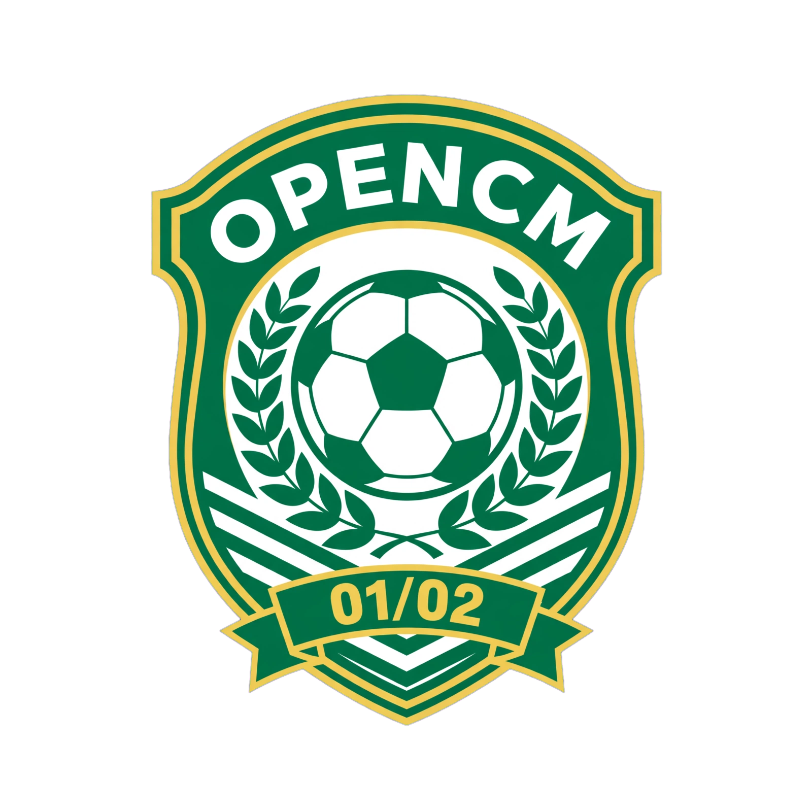

<!-- SPDX-License-Identifier: MIT -->
<!-- Copyright (c) 2026 Michele Broggi -->

<p align="center">
  
</p>

# OpenCM0102

Open-source reimplementation of Championship Manager 01/02 in Rust:
a native engine for Windows, macOS and Linux — no Wine, no original
executable at runtime.

## Legal

Only our code lives here. No `cm0102.exe`, `.dat`, `.cfg` or graphics
files are bundled. On first launch a wizard imports your own CM 01/02
disc (as an ISO image) into SQLite; originals are never modified.

## Documentation

Start at [docs/readme.md](docs/readme.md): user guide, architecture,
data formats, per-system behaviour specs (competitions, match
engine, transfers, tactics, season, players, saves), target
[versions](docs/versions.md), and the
[implementation roadmap](docs/roadmap.md).

## Status

ISO import, data explorer, database viewer, new-career flow with
native saves, main-menu shell, and a playable match engine: live
stats, cfg commentary, weather with postponements, referees and
crowds. Game-system rules are specified in `docs/` before
implementation; remaining placeholders are declared as such.

## Build

```sh
cargo build
cargo test
cargo clippy -- -D warnings
cargo run -p opencm0102
```

MIT licence — see [LICENSE](LICENSE).
